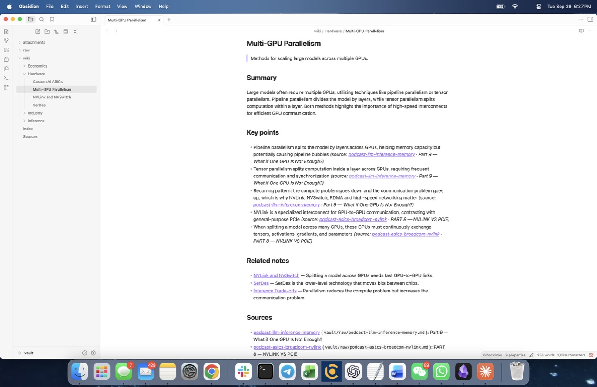
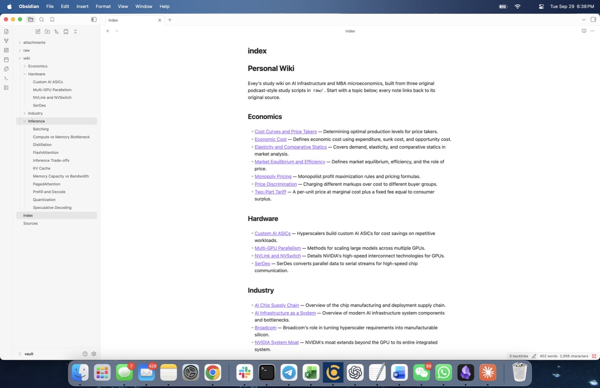
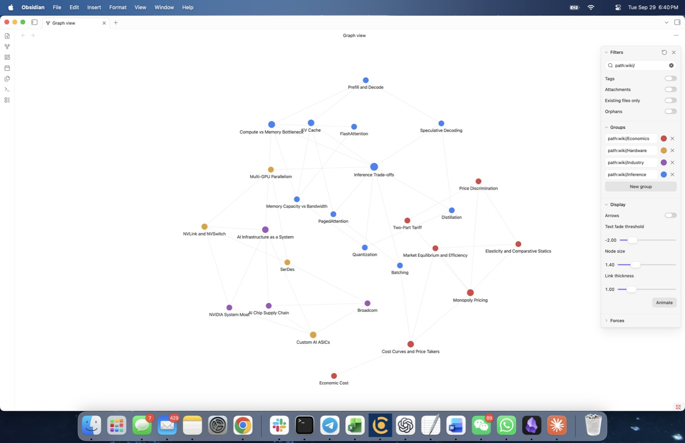
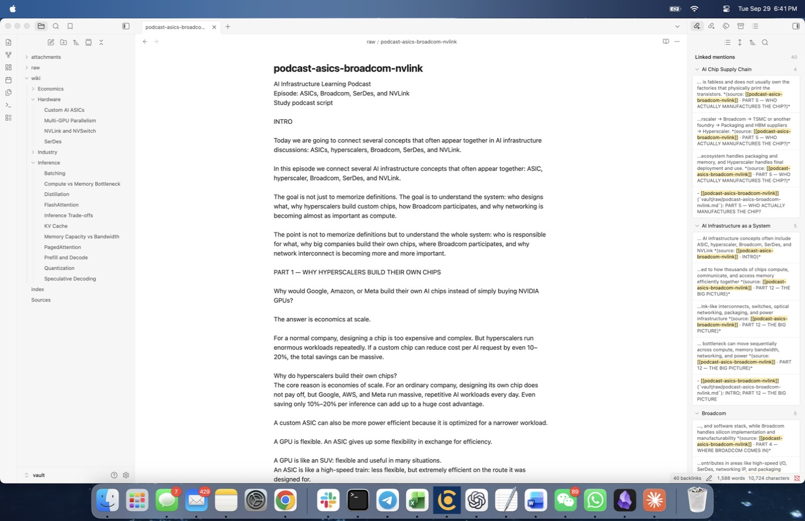

# Personal Wiki CLI: Local Gemma + RAG

A command-line personal wiki that runs fully offline on a MacBook Air. Local **Gemma 4 E4B** (Q4_K_M, via Ollama) turns three of my own study scripts into a linked Obsidian wiki, and my own Python harness exposes three modes over it: **chat** (a study assistant), **ask** (cited, evidence-only answers) and **search** (original passages, no model).

Class 5 / Assignment 4. No starter repo was used; the harness is ~1,100 lines of standard-library Python.

## Evidence at a glance

| What | Where |
|---|---|
| CLI and harness code | [`wiki`](wiki), [`wiki_cli/`](wiki_cli/) |
| Instructions loaded per mode | [`prompts/persona.md`](prompts/persona.md) (chat), [`prompts/wiki-instructions.md`](prompts/wiki-instructions.md) (ask), [`prompts/ingest-instructions.md`](prompts/ingest-instructions.md) |
| Original sources (unchanged) | [`vault/raw/`](vault/raw/) + catalog [`vault/Sources.md`](vault/Sources.md) |
| Wiki (Obsidian vault) | [`vault/index.md`](vault/index.md), [`vault/wiki/`](vault/wiki/) (26 notes in 4 topic folders) |
| Test plan, written before retrieval | [`evals/test-questions.md`](evals/test-questions.md) |
| Four ask-mode evidence cards + mode checks | [`evals/results.md`](evals/results.md) → cards in [`runs/ask/`](runs/ask/), chat transcripts in [`runs/chat/`](runs/chat/) |
| Offline run screenshots | [`docs/screenshots/offline-*.png`](docs/screenshots/) |
| Obsidian screenshots | [below](#obsidian-screenshots) |
| Wiki review and cleanup log | [`docs/wiki-cleanup.md`](docs/wiki-cleanup.md) |
| Device, model and measurements | [`docs/device-and-model.md`](docs/device-and-model.md) |

---

## 1. Purpose and sources

The wiki is a study memory for two things I am learning this semester: **AI infrastructure** (for product/strategy recruiting) and **MBA 201A microeconomics**. It should answer questions like "why is decode memory-bound?", "why do hyperscalers build ASICs?" or "why does a supply shock land on price?", and point me back to the exact passage.

| Source ID | File in `vault/raw/` | What it is |
|---|---|---|
| `src-podcast-llm-inference-memory` | `podcast-llm-inference-memory.md` | Study podcast script, "Why LLM Inference Is Really a Memory Problem" (16 parts) |
| `src-podcast-asics-broadcom-nvlink` | `podcast-asics-broadcom-nvlink.md` | Study podcast script, "ASICs, Broadcom, SerDes, and NVLink" (12 parts) |
| `src-podcast-201a-econ-review` | `podcast-201a-econ-review.md` | My MBA 201A midterm review script, Lectures 1–6 (paraphrased study aid, no exam questions) |

**How the originals were prepared (before they entered `raw/`):** the two AI scripts had short Chinese restatements, which I translated to English so the whole wiki is in English. From the econ review I removed Chapter 1 (exam strategy) and Chapter 8 (my personal past mistakes) for privacy, keeping the original chapter numbers. After that, the files have not been changed; their SHA-256 hashes are in [`vault/Sources.md`](vault/Sources.md).

**How originals connect to pages:** every wiki note has frontmatter listing its source IDs and section headings, a "(source: [[file]] · section)" tag after every key point, and a Sources section linking to the raw file. The raw files show all their incoming links under Obsidian's backlinks ([screenshot](docs/screenshots/obsidian-trace-source.jpg)).

## 2. Setup and device

| Item | Value |
|---|---|
| Machine | MacBook Air, Apple M2, **16 GB unified memory** (no dedicated VRAM; CPU and GPU share memory) |
| OS | macOS 14.5 (23F79) |
| Free disk | 309 GiB of 460 GiB |
| Python | 3.14.7 (standard library only; no `pip install`) |
| Runtime | Ollama 0.34.4 (`http://localhost:11434`) |
| Model | `gemma4:e4b`, Ollama ID `c6eb396dbd59`, quantization **Q4_K_M** (4-bit), 9.6 GB download (includes the multimodal encoders) |
| Model source | Ollama library (`ollama pull gemma4:e4b`), Google Gemma open weights. Weights are **not** in this repo. |

### Install (while online)

```bash
# 1. Ollama: download the Mac app from https://ollama.com/download and open it
ollama --version                      # 0.34.4 used here
ollama pull gemma4:e4b                # ~9.6 GB, stored in ~/.ollama
ollama show gemma4:e4b                # confirm quantization Q4_K_M

# 2. This project
git clone https://github.com/eveyyy7/personal-wiki.git
cd personal-wiki
./wiki status                         # checks Ollama, the model and the index
```

After this, nothing else is downloaded. There is no embedding model: retrieval is local BM25.

### Commands

```bash
./wiki --help                                   # commands, config, inputs
./wiki ingest ./vault/raw                       # sources -> Gemma -> linked notes, index.md, Sources.md, search index
./wiki ingest --force                           # regenerate notes (reviewed notes are never overwritten)
./wiki search "memory bandwidth"                # original passages + paths, no model
./wiki search "KV cache" --wiki                 # also show generated wiki notes (labelled 'wiki')
./wiki ask "Why is decode memory-bound?"        # standalone cited answer, or 'Insufficient evidence'
./wiki chat                                     # interactive assistant (/help, /reset, /save, /exit)
./wiki chat --say "what can you help me with?" --say "make that shorter"   # scripted chat for saved checks
./wiki ask "..." --mode local                   # local is the default; --mode online is not implemented
```

Errors are explicit: Ollama not running → "Cannot reach Ollama ... open the Ollama app"; model missing → "run: ollama pull gemma4:e4b"; a path outside `vault/raw` or with no sources → a clear message and exit code 2.

### Why E4B, and what it costs on this Mac

| Option | Memory to load (Q4_0, official estimate) | Decision |
|---|---|---|
| E2B | ~2.9 GB | Fallback if E4B were too slow |
| **E4B** | ~4.5 GB | **Chosen.** Fits comfortably in 16 GB next to macOS, Obsidian and a browser, and answers were fast enough |
| 26B A4B MoE | ~14.4 GB | Rejected: all 26B weights must be loaded, which would use nearly all 16 GB |

**Measured on this device** (from `ollama ps` / Ollama's timing fields, saved in every run record):

| Measurement | Value |
|---|---|
| Model memory while answering | **3.24 GB, 100% on GPU**, context 8,192 |
| Cold model load | 7.2–7.7 s |
| Ask-mode answer (warm) | **5.4–9.5 s** for 1.1–1.5k prompt tokens; 19.7 s including a cold load |
| Generation speed | 22.6–25.4 tokens/s |
| Chat turn | 7.9–19.3 s |
| Ingest of all 3 sources (26 notes) | 1,189 s (~20 min); first run with 15 notes 867 s |
| Re-ingest of unchanged sources | < 1 s (hash check, no model call) |

The first raw test (`ollama run ... --verbose`) spent most of its 335 output tokens on a "thinking" trace and took 21.8 s. The harness calls the API with `think: false`, which cut a comparable answer to ~9–11 s.

## 3. Architecture

```
            ┌────────────────────────── harness (wiki_cli/) ───────────────────────────┐
 you ─▶ CLI │ cli.py  → picks mode, loads that mode's instructions, handles errors      │
 (wiki)     │   search ─▶ retrieval.py (BM25 over vault/raw) ─▶ passages + paths        │── no model
            │   ask    ─▶ retrieval ─▶ research rules + numbered evidence ─▶ llm.py ─▶  │
            │             citation check ─▶ answer + sources ─▶ runs/ask/*.md           │── RAG
            │   chat   ─▶ persona + recent turns (+ notes only if needed) ─▶ llm.py     │
            │   ingest ─▶ Gemma plans/drafts notes ─▶ harness writes Markdown, links,   │
            │             index.md, Sources.md, rebuilds the index                     │
            └──────────────────────────────────────────┬────────────────────────────────┘
                                                        ▼
                                     local Gemma (Ollama, localhost only)
```

- **Model:** Gemma generates text from whatever the harness sends. It does not read files, remember conversations or call tools by itself.
- **Retrieval tool** (`retrieval.py`): a BM25 keyword index over passages. It only finds evidence. Search mode shows its output directly.
- **RAG workflow** (ask mode): retrieve → put numbered passages in the prompt → Gemma answers from them → harness checks citations. Nothing is trained.
- **Harness** (`wiki_cli/`): mode selection, instructions, conversation context, the decision whether to retrieve, prompt assembly, model calls (`llm.py` is the only file that talks to Ollama), citation checks, errors and saved outputs (`evidence.py`).
- **CLI** (`wiki`, `cli.py`): the terminal interface to the harness.

### One path traced through the code: `./wiki ask "Why would a big cloud company design its own chip...?"`

1. `wiki` → `cli.main()` parses `ask`, confirms `--mode local`, calls `modes.run_ask()`.
2. `retrieval.load_or_build()` loads `.wiki_state/index.json` (rebuilt automatically if any vault file changed) and runs BM25 over **raw** passages only. Top 5 with score ≥ 2.0 are kept. Here PART 1 of the chips script ranked first (score 21.7).
3. `run_ask` builds two messages: the system message is `prompts/wiki-instructions.md` (research rules), the user message is `EVIDENCE: [1] (path · section · lines) text ... QUESTION: ...`. **No chat history and no persona** are included.
4. `llm.check()` confirms Ollama and the model are available; `llm.chat()` POSTs to `localhost:11434/api/chat` with `think: false`, temperature 0.1, `num_ctx` 8192, streaming tokens to the terminal.
5. `check_citations()` verifies every `[n]` refers to a retrieved passage, that an answer without citations is an "Insufficient evidence" reply, and that every number in the answer appears in the cited passages.
6. The terminal shows the answer, the sources (cited ones starred), the check result, time, tokens/s and `ollama ps` memory. `evidence.save()` writes `runs/ask/<time>-<question>.json` and a Markdown evidence card.

### How each mode differs (enforced by the harness, not by hoping the model behaves)

| | chat | ask | search |
|---|---|---|---|
| Instructions | `persona.md` (Wren: voice, real capabilities, citation rules) | `wiki-instructions.md` (evidence only, cite every sentence, "Insufficient evidence:") | none |
| Conversation history | last 6 turns | never | never |
| Retrieval | only when needed (below) | always, raw sources only | always |
| Model | yes, temperature 0.6 | yes, temperature 0.1 | **no** |
| Output | reply + [N] note list | answer + sources + citation check | passages + paths + scores |

**When chat retrieves** (`decide_retrieval` in `modes.py`): no lookup for capability/greeting questions ("what can you help me with?"), for follow-ups on the previous reply ("make that shorter") or for "remember this ..." statements. Otherwise it retrieves only if the best BM25 score is ≥ 5.0; `/notes <topic>` forces a lookup. The decision and its reason are printed every turn. Retrieved notes are added for that turn only and are **not** stored in the conversation history, so chat history never becomes evidence. `/save` writes a draft to `drafts/`, outside the vault, never indexed.

## 4. Design choices

- **Passages:** sources are split at their own headings ("Part 9 — ...", "PART 6 — ...", "Chapter 5 — ..."), then into ≤ 220-word passages with a one-line overlap. Each passage keeps file path, section heading and line range, which is what citations show. 59 raw passages in total.
- **Retrieval:** BM25 with a light stemmer and stop-word list; section headings count 3× (so "SerDes" ranks "PART 6 — WHAT IS SERDES?" first). Chosen over embeddings because it needs no extra model download, works offline by construction, and every score is explainable. It handled paraphrased questions well enough in Tests 1–3.
- **How much text reaches Gemma:** ask sends at most 5 passages (~1.1–1.5k tokens total); chat sends up to 3; ingest sends up to ~2,500 words of source per note. The whole wiki is never sent.
- **Research rules vs personality:** kept in separate files and loaded only by their own mode.
- **Model settings that mattered:** `think: false` (roughly halved response time); temperature 0.1 for ask; JSON-schema output for ingest so the harness, not the model, writes filenames, frontmatter and links.

### Wiki structure

- **Folders:** `wiki/Inference`, `wiki/Hardware`, `wiki/Industry`, `wiki/Economics`, only the categories the sources need. Originals in `raw/`, `attachments/` for images. Code, index, state and test answers live **outside** `vault/`.
- **Names:** short subject names (`KV Cache.md`, `Multi-GPU Parallelism.md`, `Two-Part Tariff.md`); the first heading matches the filename. Machine IDs (`src-...`), source files, sections and review notes live in frontmatter and in [`vault/Sources.md`](vault/Sources.md).
- **Source IDs → pages:** [`wiki-plan.json`](wiki-plan.json) maps each note title to its folder and the exact source sections it draws from. It is human-editable.
- **Links:** every related link states a reason from the sources. One deliberate cross-topic link: Batching ↔ Cost Curves and Price Takers (a GPU is a fixed hourly cost, so utilization drives cost per token).
- **No duplicates on re-ingest:** unchanged sources are skipped by SHA-256; changed sources reuse their planned titles, so files are updated in place; new titles are matched case- and plural-insensitively against existing ones; notes marked `reviewed: true` are never overwritten; notes dropped from the plan are moved out of the vault to `.wiki_state/removed/`, not left behind. Tested: re-running `./wiki ingest` → "unchanged ... no notes created" for all three sources.

### Review of generated notes

Gemma's first plan had weak names, one note covering eight techniques, and gaps. I rewrote the plan (15 → 26 notes), re-ran ingest, then read every note against its source. The full log is in [`docs/wiki-cleanup.md`](docs/wiki-cleanup.md); Gemma's original plan is kept in [`docs/ingest-plan-gemma-original.json`](docs/ingest-plan-gemma-original.json). Fixes included: Two-Part Tariff and Price Discrimination mixed together; a wrong claim that SerDes is "general-purpose"; an overstated Broadcom summary; and invented reasons on related links. Each note records its own changes in `review_changes`.

## 5. Evidence

### Obsidian screenshots

Vault opened at `vault/`. Graph filter: `path:wiki/`, Attachments off, Orphans off, color groups per topic folder (Economics red, Hardware orange, Industry purple, Inference blue).

**Open note** (short filename, matching heading, per-point source references, related notes, sources):


**Topic-organized index and page list:**


**Graph view** (26 curated notes, readable labels):


**Trace back to evidence:** Multi-GPU Parallelism → NVLink and NVSwitch → the original `podcast-asics-broadcom-nvlink` file, whose backlinks list every note that cites it:


### Tests (all offline)

Summary table, mode checks and fixes: **[`evals/results.md`](evals/results.md)**. Wi-Fi was turned off, `curl https://google.com` could not connect, and the CLI was restarted before `help`, `status`, `ingest`, the four ask tests, `search` and the chat checks ([screenshots](docs/screenshots/)).

| Test | Result |
|---|---|
| 1. Egg prices (paraphrased econ question) | Pass: right passage and mechanism, one imprecise sentence |
| 2. Why build custom chips (different wording) | Pass |
| 3. Why multi-GPU needs NVLink (two sources) | Pass, both sources retrieved and cited |
| 4. Broadcom AI revenue (not in sources) | Pass: "Insufficient evidence", no invented number |
| Chat claim not used by ask | Pass |
| Casual chat, follow-up, search, re-ingest | Pass |

## 6. Reflection: a limitation and an improvement

**Limitation: keyword retrieval misses questions that share no words with the source.** BM25 only matches words. The four tests worked because their questions shared key terms with the right passage ("eggs", "chip", "GPUs", "NVLink"). When I rephrased questions without those terms, the right passage dropped out of the top 3:

| Query (search mode, no model) | Expected passage | Top 3 returned |
|---|---|---|
| "How does the model avoid redoing work for words it already processed?" | Part 4 — What is the KV Cache? | Part 2, Part 1, Part 6 ([run](runs/search/20260930-015610-how-does-the-model-avoid-redoing-work-fo.json)) |
| "Why do tech giants make their own silicon?" | PART 1 — Why hyperscalers build their own chips | PART 4, PART 5, FINAL RECAP ([run](runs/search/20260930-015610-why-do-tech-giants-make-their-own-silico.json)) |

**Cause:** the source says "KV cache", "recomputing", "hyperscalers" and "chips"; the questions say "redoing work", "tech giants" and "silicon". With no shared words, BM25 has nothing to score. In ask mode this would mean either a weaker answer or "Insufficient evidence" even though the wiki contains the answer.

**Improvement I would try:** hybrid retrieval. Add a small local embedding model through the same Ollama runtime (for example `ollama pull nomic-embed-text`, pulled while online), embed each passage once at ingest, and rank by BM25 score plus cosine similarity. It stays offline, keeps BM25's exact-term strength, and should catch paraphrases like the two above. I would re-run these two queries and the four ask tests to check that nothing regressed.

## 7. Online mode

Not implemented. `--mode online` exits with a clear message. All required behavior runs locally.

## Repository layout

```
wiki, wiki_cli/          CLI and harness
prompts/                 persona (chat), research rules (ask), ingest rules
config.json              model, Ollama URL, context size, retrieval thresholds
wiki-plan.json           reviewed note plan: title -> folder + source sections
sources-meta.json        notes on how each original was prepared
vault/                   the Obsidian vault: raw/ originals, wiki/ notes, index.md, Sources.md
evals/                   test plan (written first) and results
runs/                    every saved run: ask cards, chat transcripts, search results, ingest reports
docs/                    device/model measurements, cleanup log, screenshots
.wiki_state/             (gitignored) search index and source hashes, rebuilt by the CLI
```
